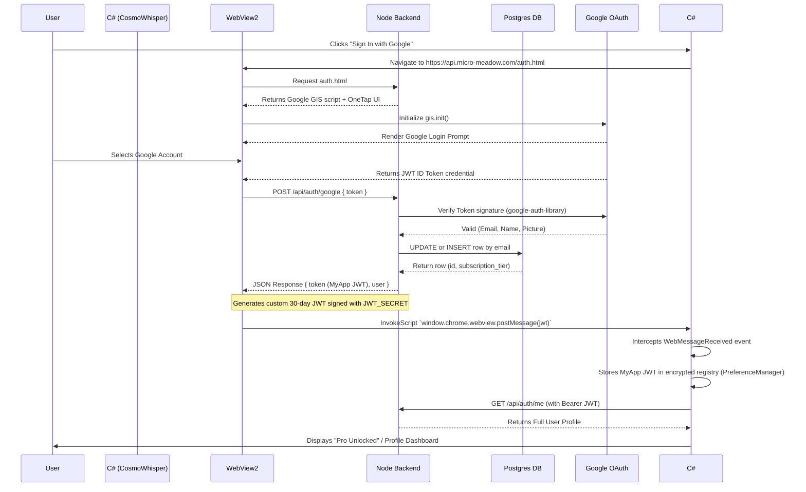

# CosmoWhisper-Native Authentication Flow

## Overview
CosmoWhisper uses an OAuth2 integration with Google Identity Services. The C# Native Desktop Application (`CosmoWhisper.exe`) embeds a `WebView2` browser control that loads a remote webpage (`/auth.html`) hosted on the Node.js backend. This isolates the complex Google login logic from the native C# code.

## Flow Diagram

## Key Components

### 1. The C# Host (`AuthenticationWindow.xaml`)
The native app opens a small dialog window containing `Microsoft.Web.WebView2.Wpf.WebView2`.
- It navigates to the backend's `/auth.html` page.
- It attaches an event handler: `WebView.WebMessageReceived += WebView_WebMessageReceived;`
- When the login is successful, the Javascript inside `auth.html` posts a message back to the native host containing the secure backend JSON Web Token (JWT).
- The dialog closes, and the JWT is permanently saved locally.

### 2. The Bridge (`auth.html`)
This HTML file is served publicly by the Express Node.js backend.
- It loads `https://accounts.google.com/gsi/client`.
- It renders the standard Google "Sign In" button.
- When clicked, a popup occurs. The user approves the login.
- Google returns a `credential` string to the `handleCredentialResponse` javascript callback.
- The script immediately sends an HTTP POST request to `/api/auth/google` with that credential.
- If the backend returns `success`, the script extracts the JWT and calls `window.chrome.webview.postMessage(jwt)`.

### 3. The Backend Validator (`routes/auth.ts`)
The true security boundary.
1. The endpoint `/api/auth/google` receives the raw Google token.
2. It uses `const client = new OAuth2Client()` from `google-auth-library` to verify the cryptographic signature against Google's public keys.
3. If valid, the backend extracts the verified `email`.
4. It connects to the Postgres DB. It attempts an `UPDATE` on the user row. If no rows are affected, it executes an `INSERT` to create a new user.
5. It signs a completely new, proprietary JWT using `jsonwebtoken.sign()` containing the `userId` and `email`, valid for 30 days. This string is returned to the client.

### 4. API Authorization (`middleware/auth.ts`)
Now that the C# app possesses the 30-day JWT, every subsequent HTTP request to the backend includes an `Authorization: Bearer <token>` header.
- The `authenticate()` middleware intercepts incoming requests to `/api/` routes (e.g., `/api/license/status`).
- It calls `jwt.verify(token, process.env.JWT_SECRET)`.
- If valid, it attaches `req.user = decoded` allowing controllers to safely know which user is asking for their statistics or limits.
